# Class Diagram — English Trainer

UML class diagram of the types used in the project (folders `Models/` and `Data/`).

Other language: [Українська версія](ClassDiagram.uk.md).



> If the preview looks small, open `docs/class-diagram.en.svg` directly (double-click in the IDE or open in a browser): SVG is vector and scales without quality loss.

## Relationships

- **PracticeSession → PracticeQuestion** — aggregation (`o--`): the session receives the question array from outside and stores a reference to it (`_questions`).
- **PracticeSession → PracticeAnswer** — composition (`*--`): answer objects are created inside the session in `SubmitAnswer` and kept in the private `_answers` list; their lifetime is bound to the session.
- **PracticeAnswer → PracticeQuestion** — association (`-->`): each answer references the question it was given for.
- **PracticeQuestionFactory → VocabularyEntry / PracticeQuestion / PracticeDirection** — dependency (`..>`): the factory builds a question with options based on a vocabulary entry and the chosen direction.
- **CsvVocabularyImporter → VocabularyEntry / VocabularyEntryMap** — dependency: the importer reads a CSV stream, applies the `VocabularyEntryMap`, and produces a `List<VocabularyEntry>`.
- **CsvVocabularyExporter → VocabularyEntry / VocabularyEntryMap** — dependency: the exporter serialises entries into a CSV string using the same mapping.
- **VocabularyEntryMap** — a CsvHelper `ClassMap<VocabularyEntry>` that binds CSV columns (`word`, `translation`, `explanation`, `example`, `type`/`partOfSpeech`) to model properties.
- **StarterQuestions** — a static helper that returns the initial question set for the chosen direction.
- **PracticeDirection** — an enum that defines the translation direction: Ukrainian → English or English → Ukrainian.

## Legend

| Symbol | Meaning |
|---|---|
| `+` | public member |
| `-` | private member |
| `$` | static method |
| `*--` | composition |
| `o--` | aggregation |
| `-->` | association (reference) |
| `..>` | dependency (uses / creates) |

---

<details>
<summary>Mermaid source (to regenerate the SVG)</summary>

Diagram source: [`docs/class-diagram.en.mmd`](docs/class-diagram.en.mmd)

Regenerate the image:

```bash
npx -y -p @mermaid-js/mermaid-cli mmdc \
  -i docs/class-diagram.en.mmd \
  -o docs/class-diagram.en.svg \
  -t dark -b transparent
```

</details>
