# Схема класів — English Trainer

UML-схема класів, які використовуються у проєкті (папки `Models/` та `Data/`).

Інша мова: [English version](ClassDiagram.en.md).



> Якщо діаграма у попередньому перегляді виглядає маленькою — відкрий файл `docs/class-diagram.uk.svg` напряму (подвійним кліком у IDE або у браузері): SVG векторний і масштабується без втрати якості.

## Пояснення зв'язків

- **PracticeSession → PracticeQuestion** — агрегація (`o--`): сесія отримує масив запитань ззовні і зберігає посилання на них (`_questions`).
- **PracticeSession → PracticeAnswer** — композиція (`*--`): об'єкти відповідей створюються всередині сесії у `SubmitAnswer` та зберігаються у внутрішньому списку `_answers`; їхній час життя обмежений сесією.
- **PracticeAnswer → PracticeQuestion** — асоціація (`-->`): кожна відповідь посилається на запитання, на яке вона дана.
- **PracticeQuestionFactory → VocabularyEntry / PracticeQuestion / PracticeDirection** — залежність (`..>`): фабрика на основі словникових записів і обраного напрямку створює запитання з варіантами відповідей.
- **CsvVocabularyImporter → VocabularyEntry / VocabularyEntryMap** — залежність: імпортер читає CSV, використовує мапінг `VocabularyEntryMap` та створює колекцію `VocabularyEntry`.
- **CsvVocabularyExporter → VocabularyEntry / VocabularyEntryMap** — залежність: експортер серіалізує записи у CSV-рядок, використовуючи той самий мапінг.
- **VocabularyEntryMap** — `ClassMap<VocabularyEntry>` з CsvHelper: описує відповідність колонок CSV (`word`, `translation`, `explanation`, `example`, `type`/`partOfSpeech`) властивостям моделі.
- **StarterQuestions** — статична утиліта, що повертає початковий набір запитань для обраного напрямку.
- **PracticeDirection** — перелік (enum), що визначає напрямок перекладу: з української на англійську або навпаки.

## Позначення

| Символ | Значення |
|---|---|
| `+` | публічний член (public) |
| `-` | приватний член (private) |
| `$` | статичний метод |
| `*--` | композиція |
| `o--` | агрегація |
| `-->` | асоціація (посилання) |
| `..>` | залежність (використання/створення) |

---

<details>
<summary>Початковий код Mermaid (для перегенерації SVG)</summary>

Файл з кодом діаграми: [`docs/class-diagram.uk.mmd`](docs/class-diagram.uk.mmd)

Перегенерувати зображення:

```bash
npx -y -p @mermaid-js/mermaid-cli mmdc \
  -i docs/class-diagram.uk.mmd \
  -o docs/class-diagram.uk.svg \
  -t dark -b transparent
```

</details>
